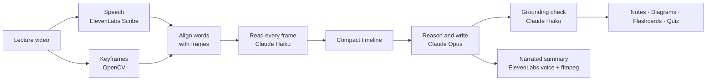

# Engram

*An engram is the physical trace a memory leaves in the brain. Engram leaves one for every lecture.*

**Upload a lecture video and get a course back:** chaptered notes, diagrams, flashcards, a quiz and a narrated summary video of about 80 seconds. Every item links to the moment in the lecture it came from.

Engram listens to the talk, reads the slides and the whiteboard from the video frames (handwriting included), and lines the two up in time. The words spoken while a frame was on screen help it read that frame, and every note can cite exactly where it came from.

> Status: working end to end at https://engram.devanshitiwari.com (uploads need an access code). Evals are in; launch polish is next. The plan is in [docs/PLAN.md](docs/PLAN.md).

## How it works



- **Cheap eyes, expensive brain.** Haiku reads every frame for about $0.15 per hour of lecture. Opus works from a compact text timeline and opens only the frame images it actually relies on.
- **Grounded output.** Every note, card and quiz question carries an anchor (a frame or a quote), which code resolves to a timestamp. A second model checks every flashcard and quiz answer against what was said and written, and anything it can't find in the lecture is removed.
- **Built for long lectures.** Every stage is cached by a hash of its inputs, so a crash or a prompt change re-runs only what changed.

## How well it works

Measured on two lectures, Stanford CS229 lecture 2 (whiteboard, the lecturer often in front of it, a moving camera) and MIT 18.06 lecture 1 (blackboard, 320×240). Run `uv run engram eval`; the full report is [evals/report.md](evals/report.md).

| Check | Result |
|---|---|
| **Board states caught** (a person marked every moment a board was about to change; did Engram keep a frame of it?) | CS229 **22 of 23** (96%) · MIT 18.06 **5 of 5** |
| **Real flashcards and quiz questions kept** by the grounding check | **86 of 86** |
| **Planted wrong answers removed** | **30 of 30** |
| **Planted swapped answers removed** (a true fact from the same chapter that doesn't answer the question) | **55 of 56** |

- **The one missed board** (CS229 at 10:05) is a board Ng was still adding to. Engram kept it 27 seconds later, with more written on it, so its content isn't lost; the score counts it as missed anyway.
- **Extra frames:** Engram keeps more frames than there are board states (37 for 23 in CS229), mostly half-written boards and camera reframings. Reading each costs Haiku about $0.0006, so catching every state matters more than trimming them.
- **Handwriting accuracy isn't scored.** Ng's handwriting at 720p is often unreadable without hearing what he's saying, so a person's transcription of the bare frames would be a guess, not an answer key. Engram reads frames together with the words spoken at that moment, and Opus re-opens unclear frames itself.

## Run it locally

You need Python 3.12, [uv](https://docs.astral.sh/uv/), ffmpeg, Node 18+ (for checking Mermaid diagrams), and the [Claude Code](https://claude.com/claude-code) CLI, logged in.

```bash
cp .env.example .env      # add your ElevenLabs and Anthropic keys
uv sync && npm ci --prefix tools/mermaid
uv run engram serve      # http://127.0.0.1:4810
```

## Development

```bash
uv run pytest             # offline and free: fake speech, voice and LLM backends
uv run ruff check . && uv run mypy engram tests
```

| Doc | What's in it |
|---|---|
| [PLAN.md](docs/PLAN.md) | Goals, pipeline, milestones, risks |
| [ARCHITECTURE.md](docs/ARCHITECTURE.md) | How the code is laid out and how a job flows through it |
| [LEARNING.md](docs/LEARNING.md) | Every design decision, why it was made, and what else was considered |
