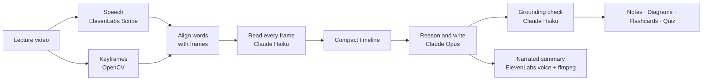

# Engram

*An engram is the physical trace a memory leaves in the brain. Engram leaves one for every lecture.*

**Upload a lecture video and get a course back:** chaptered notes, diagrams, flashcards, a quiz and a 90-second narrated summary video. Every item links to the moment in the lecture it came from.

Engram listens to the talk, reads the slides and the whiteboard from the video frames (handwriting included), and lines the two up in time. The words spoken while a frame was on screen help it read that frame, and every note can cite exactly where it came from.

> Status: in development. The build plan is in [docs/PLAN.md](docs/PLAN.md).

## How it works



- **Cheap eyes, expensive brain.** Haiku reads every frame for about $0.15 per hour of lecture. Opus works from a compact text timeline and opens only the frame images it actually relies on.
- **Grounded output.** Every note, card and quiz question carries an anchor (a frame or a quote), which code resolves to a timestamp. A second model checks every flashcard and quiz answer against what was said and written, and anything it can't find in the lecture is removed.
- **Built for long lectures.** Every stage is cached by a hash of its inputs, so a crash or a prompt change re-runs only what changed.

## Run it locally

You need Python 3.12, [uv](https://docs.astral.sh/uv/), ffmpeg, Node 18+ (for checking Mermaid diagrams), and the [Claude Code](https://claude.com/claude-code) CLI, logged in.

```bash
cp .env.example .env      # add your ElevenLabs and Anthropic keys
uv sync && npm ci --prefix tools/mermaid
uv run engram serve      # http://127.0.0.1:4810
```

## Development

```bash
uv run pytest             # offline and free: fake speech, voice and LLM backends
uv run ruff check . && uv run mypy engram tests
```

| Doc | What's in it |
|---|---|
| [PLAN.md](docs/PLAN.md) | Goals, pipeline, milestones, risks |
| [ARCHITECTURE.md](docs/ARCHITECTURE.md) | How the code is laid out and how a job flows through it |
| [LEARNING.md](docs/LEARNING.md) | Every design decision, why it was made, and what else was considered |
