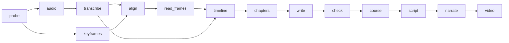

# Architecture

This document grows with each milestone. It describes what exists today, not the plan (that's [PLAN.md](PLAN.md)).

## Code layout

```
engram/
  config.py         Settings from the environment and .env. Placeholder values count as unset.
  errors.py         EngramError and friends: failures with a message a person can read
  cli.py            `engram run VIDEO`, `engram jobs`, `engram serve`
  media/ffmpeg.py   ffprobe (validate + read streams) and audio extraction
  speech/
    models.py       Word, Segment, Transcript, and the Transcriber protocol
    scribe.py       ElevenLabs Scribe client: retries, credit errors, balance check
    segments.py     Words → sentence-sized segments
    fake.py         Scripted transcriber for tests
  vision/
    keyframes.py    Views, best frame per view, consolidation (see below)
  llm/
    claude_code.py  Headless `claude -p`: keys stripped, minimal session, read-only, schema-checked
    frames.py       FrameReading schema + prompt; Haiku via the API, Claude Code fallback, fake
    reasoner.py     Opus via Claude Code (reads the timeline, opens only the frames it needs)
    judge.py        Haiku as an independent checker (API, or Claude Code without a key)
  timeline/
    align.py        Words → the frame on screen when they were said
    compact.py      Flags + the compact timeline.md Opus reads
    anchor.py       A frame id or a quote → a timestamp and a thumbnail
    text.py         Letter-trigram matching, shared by the timeline and anchors
  course/
    prompts.py      Every course prompt, with PROMPT_VERSION in every cache key
    schemas.py      What Opus must return (chapters, chapter content) and the judge's verdicts
    chapters.py     Timeline → entries; one-pass or map-reduce chaptering; boundary checks
    generate.py     One Opus call per chapter; Mermaid repair
    mermaid.py      Mermaid's own parser in Node (tools/mermaid), the version the page uses
    grounding.py    Source passages per card and question, and the Haiku verdicts
    assemble.py     course.json and the Markdown export
    script.py       The summary script: Opus picks the story and frames; code keeps it speakable
  voice/
    elevenlabs.py   ElevenLabs TTS with character timings → word timings
    fake.py         A quiet tone, three words a second, for tests
  render/
    design.py       Title cards, heading chips, caption lines (Pillow, Inter, DevSwarm colours)
    captions.py     Word timings → caption chunks, and WebVTT
    compose.py      Shots, Ken Burns, crossfades, captions → ffmpeg, landscape and portrait
    fonts/          Inter 4.0 (SIL Open Font Licence)
  vision/similar.py Perceptual hash: the same slide shown twice is read once
  pipeline/
    store.py        SQLite: jobs, stages, progress events
    runner.py       The DAG runner, stage context, paid-call cache
    stages.py       The stages themselves
    thinking.py     Opus calls, cached in the paid cache and recorded (time, tokens, files opened)
    hashing.py      File and data hashes that decide what's stale
  worker.py         The queue: runs queued jobs one at a time, requeues interrupted ones
  web/
    app.py          Routes: upload, job page, course page, media, transcript, downloads
    course.py       The course page's data: Markdown + maths, shuffled quiz, transcript
    exports.py      Markdown zip and Anki file
    templates/      Jinja: home, job (live), course, print
    static/         theme.css (DevSwarm, unchanged), engram.css, course.js, vendor/
```

## A job

`engram run lecture.mp4` hashes the file. If a job for those exact bytes already exists, it **resumes** it. Otherwise it creates a new one. Everything a job produces lives in `.data/jobs/<id>/`:

| Stage | Reads | Writes | Notes |
|---|---|---|---|
| `probe` | the video | `media.json` | Rejects files with no video or no audio stream, or longer than `ENGRAM_MAX_MINUTES` (120) |
| `audio` | the video | `audio.mp3` | Mono 16 kHz, 64 kbps, no tags, bit-exact. The same speech always gives the same bytes |
| `transcribe` | `audio.mp3` | `transcript.json` | Scribe with word timestamps and speakers. The job title is sent as key terms |
| `playback` | the video | `playback.json` (+ `playback.mp4`) | The upload as it is if it's H.264/AAC MP4, else an H.264 copy at most 720p for browsers. CS229 (AV1): 11.5 min, 502 MB |
| `keyframes` | the video | `keyframes.json`, `frames/` | Runs alongside audio and transcription. Full-size JPEGs of the best frame per view |
| `align` | transcript, keyframes | `alignment.json` | Spans: one frame, a time range, the words spoken over it |
| `read_frames` | frames, alignment | `readings.json` | Haiku reads each frame with the words spoken while it was up. 8 in parallel, cached by image + context |
| `timeline` | transcript, alignment, readings | `timeline.md`, `flags.json` | What Opus reads: frames and speech interleaved, repeats and fillers removed |
| `chapters` | timeline | `chapters.json` | Opus: title, overview, 4-12 chapters. Boundaries checked against real stamps |
| `write` | timeline, chapters | `content.json` | Opus per chapter, 4 at a time: notes, key terms, diagrams, cards, quiz. Opens frames itself |
| `check` | content, transcript, readings | `grounding.json` | Haiku checks every card and question against the source passages |
| `course` | all of the above | `course.json`, `course.md`, `thumbs/` | Anchors → timestamps; unsupported items removed and recorded |
| `script` | course, readings | `script.json` | Opus: 6-8 scenes, 150-190 words, each on a frame it picked from the thumbnails |
| `narrate` | script | `narration.mp3`, `narration.json` | ElevenLabs, the configured voice, with the time of every word. Cached by text + voice |
| `video` | script, narration, frames | `summary.mp4`, `summary-portrait.mp4`, `summary.jpg`, `summary.vtt` | 1920×1080 and 1080×1350, 30 fps, H.264 + AAC, rendered in parallel |



## Keyframes

A filmed lecture isn't a screen recording. The camera follows the lecturer, so every frame differs from the last, and the lecturer usually stands in front of the board. `vision/keyframes.py` works on **ink** instead of pixels, and on **views** (what the camera points at) instead of single frames. It makes one pass at 1 fps, 480 px wide, decoded by a single ffmpeg pipe (about 30× real time for 720p AV1).

| Step | How |
|---|---|
| Ink | A black-hat filter keeps thin dark strokes (white-hat on a blackboard). Board edges and the pen tray are dropped. |
| Person | A tall shape that stands on the floor (reaches the bottom of the frame, or fills most of its height). Its *tall columns* become the person region, so writing that merely touches their outline isn't swallowed. Ink inside the region doesn't count. |
| Camera motion | The board is moving when its pixels, the person excluded, change on average by 8 grey levels or more. Then phase correlation on the **ink maps** gives the pan, accepted only when the match is confident. A view ends after a pan of ¼ of the frame. |
| Cut | The histogram correlation drops below 0.5 *and* the mean pixel change exceeds 45. Pans peak at about 33, cuts are about 90. |
| Change | Visible ink falls below 30% of the view's best at once, or below 60% for 4 s: the board was wiped, or a zoom or the lecturer hid it. |
| Best frame | The still frame with the most visible ink × (1 − ½ person share) × sharpness. Later frames win within 5%, because they show the finished board. |
| Overlay | Ink present in 70% of all frames is a logo, not writing. |
| Consolidation | ORB features taken from the writing only, plus a RANSAC similarity transform (a pure ink shift when there's too little writing for features). Backwards pass: a frame is dropped if the frames after it, within 3 min, show 80% of its ink between them. Forwards pass: a revisit that adds nothing is dropped. Dropped frames hand their time ranges to the frame that shows the same board. |

On CS229 Lecture 2 (78 min, 720p): 4,697 samples → 162 views → **120 keyframes** in 156 s, running alongside transcription.

## Alignment

`timeline/align.py` sorts every view (frame id, start, end), stretches them to tile `0..duration`, and puts each word in the view containing its midpoint. Consecutive views of the same frame merge into one span. A frame the camera returns to later gets a second span. Each span keeps the index range of its words, so later stages can quote exactly what was said while a frame was on screen.

## The runner

Each stage declares its dependencies, its output files, a version number and any parameters that change its result (such as which transcriber is used). Before running a stage, the runner computes its **input key**:

```
sha256(stage name, version, parameters, source video hash, output digests of its dependencies)
```

A stage is skipped when its key matches the last successful run *and* its outputs on disk still hash to what that run produced. That gives:

- **Resume after a crash.** A stage is marked done only after its outputs are complete, and JSON is written atomically. A killed run picks up at the first unfinished stage.
- **Cheap reruns.** Re-running a finished job takes about half a second and calls nothing.
- **Exact invalidation.** Bump a stage's `version` and that stage re-runs. Downstream stages re-run only if its output bytes actually changed.
- **Tamper detection.** Editing or deleting an output file makes that stage stale.

Independent stages run in parallel threads. A failed stage marks everything downstream of it `blocked`, while other branches finish. The full traceback goes to `engram.log` in the job folder. The database keeps one readable line, such as `ffprobe failed: Invalid data found when processing input`.

## Paid-call cache

Paid API results are also cached **across jobs**, in `.data/cache/<kind>/<key>.json`. For transcripts, the key is the hash of the audio bytes, the transcriber and the key terms. A lecture uploaded twice, or re-muxed into another container, is transcribed once. After each paid transcription, the stage checks the ElevenLabs balance and posts a warning event when less than an hour of lecture is left.

## Store

SQLite in WAL mode at `.data/engram.sqlite3`. Every call opens a short-lived connection, so stage threads and the web app can use it at the same time. Tables: `jobs`, `stages` (status, input key, output digest, attempts, timings, detail, error, cost) and `events` (the progress feed the job page will show).

## Web app

- **Server-rendered.** FastAPI renders Jinja templates. The job page refreshes itself with HTMX every 2 s, and the course page has one plain script (`static/course.js`). No frontend build step.
- **The web app never processes a lecture.** An upload is saved to `.data/uploads/`, checked with ffprobe (a video, within the length limit), and recorded as a queued job. `engram worker`, a separate process, runs queued jobs oldest first, one at a time. Restarting the site never interrupts a lecture, and a stopped worker's job is queued again on start-up and resumes from its last finished stage.
- **Uploads need an access code** (`ENGRAM_ACCESS_CODES`, compared in constant time) and `engram serve --uploads`. Uploading the same bytes again reuses the existing job.
- **Courses are unlisted by default.** A course page lives at `/courses/<job id>`. Only courses marked with `engram list <job>` appear on the home page.
- **Files are served from an allowlist** (`frames/f0000.jpg`, `thumbs/…`, `summary*.mp4`, `summary.jpg`, `summary.vtt`), matched by a regular expression, never by joining paths. Transcripts, readings, logs and the database stay private. Video is served with HTTP range requests, so seeking works.
- **Security headers on every response.** The Content-Security-Policy allows scripts only from the app itself (KaTeX and Mermaid are vendored in `static/vendor/`, no CDN), so text read off a slide can never run as code. Styles may be inline, because KaTeX and Mermaid position maths and diagrams with style attributes.
- **Untrusted text, rendered safely.** Model output and board text go through markdown-it with raw HTML off, and Jinja autoescapes the rest. Maths is found on the server by Pandoc's rules and wrapped in `<span class="tex">`, and the browser typesets only those spans, so "price in $1000s" stays text.
- **Host header allowlist** (`TrustedHostMiddleware`) blocks DNS-rebinding attacks.

### The course page

| Part | What it does |
|---|---|
| Player | The lecture (or its web copy). Every timestamp, chapter, board image and filmstrip frame seeks it, starting 2 s early for context |
| Transcript | Loaded from `transcript.json` (paragraphs of `[start, end, word]`). The current word is highlighted and kept in view unless you've just scrolled; clicking a word seeks to it. Students are marked |
| Chapters | Sidebar, following the playhead |
| Notes | Per chapter: summary, sections with the clearest board image (once per chapter), points with timestamps, key terms, diagrams |
| Diagrams | Mermaid, drawn when their tab is first shown (Mermaid can't measure hidden elements) |
| Flashcards | One card at a time: Space turns it, 1 "again" (back of the queue), 2 "got it" (remembered in `localStorage`). Filter by chapter. Without JavaScript, a plain list |
| Quiz | Options shuffled per question (seeded by its id, so the answer isn't always where Opus put it). Instant feedback, explanation, "rewatch" link, running score |
| Summary | The landscape video with captions; downloads for both shapes |
| Downloads | Notes as a Markdown zip with the board images; an Anki import file (tab-separated, `#deck`/`#html`/`#tags` header, maths as `\(…\)` for Anki's MathJax); a print page laid out for paper and PDF |

## Theme

The look is DevSwarm's: Apple's palette (`#f5f5f7` page, `#1d1d1f` ink, `#0071e3` action), the system font stack, a frosted sticky header, 22px card radius, pill buttons, and a sun/moon switch for night mode. Light is the default. `theme.css` is never edited, so the two products stay identical. Anything new goes in `engram.css` and uses only `var(--…)` tokens.

## Reading frames (Haiku)

Each frame goes to Claude Haiku 5.5 with the image at full size and a short context: the lecture title, when the frame was on screen, and **what the lecturer said meanwhile** (up to 3,000 characters). Lecturers say what they write, so the speech settles ambiguous handwriting. The output is a `FrameReading`: kind, title, description, verbatim `key_text` (maths in LaTeX, `[?]` for anything unreadable), equations, a diagram description, confidence and a review reason.

- **Cost:** on CS229 (78 min), 118 frames in 58 s for $0.066 (about 2,700 input tokens per frame).
- **Repeats:** frames whose 256-bit difference hashes differ by 6 bits or less are read once, so a slide shown at 22:52 and again at 34:22 costs one call.
- **Cache:** readings are stored by image bytes + reader + prompt version + context, across jobs. Changing the prompt version re-reads.
- **Failures:** a frame that can't be read gets an empty, flagged reading, and the job goes on. If most frames fail, the stage fails with the first error. Running out of credits stops the job with a readable message.
- **No API key?** `ClaudeCodeFrameReader` reads through `claude -p --model haiku` on the plan instead, opening the image with the Read tool.

## Headless Claude Code

`llm/claude_code.py` runs `claude -p` so that it costs little and can do little:

| Flag | Why |
|---|---|
| keys removed from the environment | With `ANTHROPIC_API_KEY` set, Claude Code bills the API, not the plan |
| `--system-prompt` (replaces the default) | Claude Code's own prompt is about 21,000 tokens of coding-agent instructions |
| `--tools Read` (or none), `--strict-mcp-config`, `--setting-sources ""`, `--disable-slash-commands` | Only what the job needs. Lecture text can't reach a shell or the network |
| `--no-session-persistence` | Nothing saved between calls |
| `--json-schema` | Claude Code validates the answer; Engram parses `structured_output` into Pydantic |
| `cwd` = the job folder | `Read` sees that lecture's frames and nothing else |

A trivial call went from about 43,000 input tokens to 1,845. Opus checking one flagged frame takes about 16 s, 3 turns and 6,500 input tokens.

## The timeline

`timeline.md` is what Opus reads instead of 120 images. Frames and speech appear in time order. Writing shown before isn't repeated: lines are matched on letter trigrams, because Haiku transcribes the same writing slightly differently each time. Fillers ("um", "uh") are dropped, and students are marked `(student)`. Flags (`⚠`) cover doubtful speech, low-confidence frames with real writing on them, and moments where the lecturer says "as you can see" while the reading says little. On CS229 it's 97 KB, with 68 of 120 frames shown and 30 flags.

## The course (M4)

Four stages turn the timeline into a course. Opus does the thinking; code does everything that can be checked.

1. **Chapters.** Opus reads the whole timeline in one call (up to 150 KB, about 40,000 tokens: a two-hour lecture). Longer timelines are chaptered in 15-minute windows and merged in one more call. Opus must give each start as a stamp from the timeline. Code snaps it to the nearest real line, sorts the chapters, drops any shorter than a minute and starts the first at 0:00.
2. **Write.** One Opus call per chapter, four at a time. Each sees its own slice of the timeline, the outline of every chapter (so chapters don't repeat each other) and the frame folder. It must open every flagged frame and every frame an item relies on, and report readings that turned out wrong (`corrections`). Engram records which files it actually opened, from Claude Code's event stream, rather than asking.
3. **Diagrams** are parsed with Mermaid 11.4.1 in Node before anyone sees them. A failure gets one repair call with the parser's error message. If it still fails, the diagram is dropped and recorded.
4. **Check.** For every flashcard and quiz question, code gathers the source passages: the speech from 40 s before to 70 s after its anchor, the speech around its quoted evidence, and the writing on the frames shown then. Haiku, a different model from the one that wrote the item, decides `supported`, `unsupported` or `ambiguous`. Only `supported` items stay. The rest are kept in `course.json` under `removed`, with the reason.
5. **Assemble.** Every anchor becomes a time: a quote is matched to the word where it starts (letter trigrams over 60-word windows, ties to the earliest match, the item's own chapter first). A frame anchor uses that frame's time on screen within the chapter. An item that can't be placed gets no time and is listed under `unplaced`.

Every Opus and Haiku answer is cached by its exact prompt, so re-running a job, or a stage whose inputs didn't change in substance, asks nothing again. The prompt goes to `claude -p` on stdin, because a timeline is bigger than the 128 KB a single command-line argument may be.

## The summary video (M5)

1. **Script.** Opus reads the finished course (not the timeline: the course is already the distilled lecture) and the frames the course uses, with Haiku's description of each. It opens thumbnails (480 px, cheap) to pick frames that are sharp and show the idea. It writes 6-8 scenes: a title card, one scene per big idea, and a closing line. Code then makes it speakable (symbols and subscripts to words: `θⱼ := θⱼ − α` → "theta j becomes theta j minus alpha"), turns unknown frame ids into title cards, and if it's over 200 words, asks once for a shorter version.
2. **Narrate.** One ElevenLabs call for the whole script (one take sounds more natural than stitched scenes), `eleven_multilingual_v2`, with character timings, which become word timings. The recording is cached by text and voice: re-rendering never pays twice.
3. **Video.** Each scene starts when its first word is spoken. Frames get a slow move (10% zoom) towards the writing: the centre of mass of the board's ink. Slides recorded with black bars are trimmed and shown whole on the page colour. Shots crossfade over 0.45 s. Captions are split by sentence, then into even pieces, and fill in word by word. A 2.8 s end card closes it.
   - **Landscape:** the frame fills the screen, the heading sits in a frosted pill, captions in a dark pill.
   - **Portrait (LinkedIn, 4:5):** heading above, the frame in a rounded 4:3 card with DevSwarm's shadow, captions in ink below.
   - Frames are drawn in Python (OpenCV for the moves, Pillow for text) and piped raw to ffmpeg (x264 CRF 20, AAC 160k, faststart). About 11 ms per landscape frame and 21 ms per portrait frame before encoding; both render in parallel.
