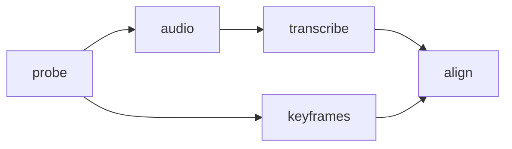

# Architecture

This document grows with each milestone. It describes what exists today, not the plan (that's [PLAN.md](PLAN.md)).

## Code layout

```
engram/
  config.py         Settings from the environment and .env. Placeholder values count as unset.
  errors.py         EngramError and friends: failures with a message a person can read
  cli.py            `engram run VIDEO`, `engram jobs`, `engram serve`
  media/ffmpeg.py   ffprobe (validate + read streams) and audio extraction
  speech/
    models.py       Word, Segment, Transcript, and the Transcriber protocol
    scribe.py       ElevenLabs Scribe client: retries, credit errors, balance check
    segments.py     Words → sentence-sized segments
    fake.py         Scripted transcriber for tests
  vision/
    keyframes.py    Views, best frame per view, consolidation (see below)
  timeline/
    align.py        Words → the frame on screen when they were said
  pipeline/
    store.py        SQLite: jobs, stages, progress events
    runner.py       The DAG runner, stage context, paid-call cache
    stages.py       The stages themselves
    hashing.py      File and data hashes that decide what's stale
  web/              FastAPI app, templates, DevSwarm theme (see below)
```

## A job

`engram run lecture.mp4` hashes the file. If a job for those exact bytes already exists, it **resumes** it. Otherwise it creates a new one. Everything a job produces lives in `.data/jobs/<id>/`:

| Stage | Reads | Writes | Notes |
|---|---|---|---|
| `probe` | the video | `media.json` | Rejects files with no video or no audio stream, or longer than `ENGRAM_MAX_MINUTES` (120) |
| `audio` | the video | `audio.mp3` | Mono 16 kHz, 64 kbps, no tags, bit-exact. The same speech always gives the same bytes |
| `transcribe` | `audio.mp3` | `transcript.json` | Scribe with word timestamps and speakers. The job title is sent as key terms |
| `keyframes` | the video | `keyframes.json`, `frames/` | Runs alongside audio and transcription. Full-size JPEGs of the best frame per view |
| `align` | transcript, keyframes | `alignment.json` | Spans: one frame, a time range, the words spoken over it |



## Keyframes

A filmed lecture isn't a screen recording. The camera follows the lecturer, so every frame differs from the last, and the lecturer usually stands in front of the board. `vision/keyframes.py` works on **ink** instead of pixels, and on **views** (what the camera points at) instead of single frames. It makes one pass at 1 fps, 480 px wide, decoded by a single ffmpeg pipe (about 30× real time for 720p AV1).

| Step | How |
|---|---|
| Ink | A black-hat filter keeps thin dark strokes (white-hat on a blackboard). Board edges and the pen tray are dropped. |
| Person | A tall shape that stands on the floor (reaches the bottom of the frame, or fills most of its height). Its *tall columns* become the person region, so writing that merely touches their outline isn't swallowed. Ink inside the region doesn't count. |
| Camera motion | The board is moving when its pixels, the person excluded, change on average by 8 grey levels or more. Then phase correlation on the **ink maps** gives the pan, accepted only when the match is confident. A view ends after a pan of ¼ of the frame. |
| Cut | The histogram correlation drops below 0.5 *and* the mean pixel change exceeds 45. Pans peak at about 33, cuts are about 90. |
| Change | Visible ink falls below 30% of the view's best at once, or below 60% for 4 s: the board was wiped, or a zoom or the lecturer hid it. |
| Best frame | The still frame with the most visible ink × (1 − ½ person share) × sharpness. Later frames win within 5%, because they show the finished board. |
| Overlay | Ink present in 70% of all frames is a logo, not writing. |
| Consolidation | ORB features taken from the writing only, plus a RANSAC similarity transform (a pure ink shift when there's too little writing for features). Backwards pass: a frame is dropped if the frames after it, within 3 min, show 80% of its ink between them. Forwards pass: a revisit that adds nothing is dropped. Dropped frames hand their time ranges to the frame that shows the same board. |

On CS229 Lecture 2 (78 min, 720p): 4,697 samples → 162 views → **120 keyframes** in 156 s, running alongside transcription.

## Alignment

`timeline/align.py` sorts every view (frame id, start, end), stretches them to tile `0..duration`, and puts each word in the view containing its midpoint. Consecutive views of the same frame merge into one span. A frame the camera returns to later gets a second span. Each span keeps the index range of its words, so later stages can quote exactly what was said while a frame was on screen.

## The runner

Each stage declares its dependencies, its output files, a version number and any parameters that change its result (such as which transcriber is used). Before running a stage, the runner computes its **input key**:

```
sha256(stage name, version, parameters, source video hash, output digests of its dependencies)
```

A stage is skipped when its key matches the last successful run *and* its outputs on disk still hash to what that run produced. That gives:

- **Resume after a crash.** A stage is marked done only after its outputs are complete, and JSON is written atomically. A killed run picks up at the first unfinished stage.
- **Cheap reruns.** Re-running a finished job takes about half a second and calls nothing.
- **Exact invalidation.** Bump a stage's `version` and that stage re-runs. Downstream stages re-run only if its output bytes actually changed.
- **Tamper detection.** Editing or deleting an output file makes that stage stale.

Independent stages run in parallel threads. A failed stage marks everything downstream of it `blocked`, while other branches finish. The full traceback goes to `engram.log` in the job folder. The database keeps one readable line, such as `ffprobe failed: Invalid data found when processing input`.

## Paid-call cache

Paid API results are also cached **across jobs**, in `.data/cache/<kind>/<key>.json`. For transcripts, the key is the hash of the audio bytes, the transcriber and the key terms. A lecture uploaded twice, or re-muxed into another container, is transcribed once. After each paid transcription, the stage checks the ElevenLabs balance and posts a warning event when less than an hour of lecture is left.

## Store

SQLite in WAL mode at `.data/engram.sqlite3`. Every call opens a short-lived connection, so stage threads and the web app can use it at the same time. Tables: `jobs`, `stages` (status, input key, output digest, attempts, timings, detail, error, cost) and `events` (the progress feed the job page will show).

## Web app

- **Server-rendered.** FastAPI renders Jinja templates. Live parts (job progress) will refresh with HTMX, so there's no frontend build step.
- **Security headers on every response**, including static files and errors. A strict Content-Security-Policy (`script-src 'self'`, no inline script or style) means text read off a slide can never run as code, even if escaping were missed somewhere.
- **Host header allowlist** (`TrustedHostMiddleware`) blocks DNS-rebinding attacks on the local server.
- **Uploads are off until the pipeline is wired into the web app (M6).** `create_app(accept_uploads=...)` and at least one access code must both be set.

## Theme

The look is DevSwarm's: Apple's palette (`#f5f5f7` page, `#1d1d1f` ink, `#0071e3` action), the system font stack, a frosted sticky header, 22px card radius, pill buttons, and a sun/moon switch for night mode. Light is the default. `theme.css` is never edited, so the two products stay identical. Anything new goes in `engram.css` and uses only `var(--…)` tokens.
