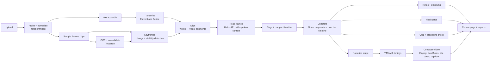

# Engram: build plan

> **Engram**: the trace a memory leaves in the brain. Upload a lecture video and get back a course:
> chaptered notes, diagrams, flashcards, a quiz and a 60–90 second AI-narrated summary video.
> Every item links back to the exact moment in the lecture it came from.

## 1. Goals

| Goal | What "done" looks like |
|---|---|
| Showcase quality | Every page uses the DevSwarm Apple theme. No dead ends, no raw errors or spinners without progress. Works on mobile and in light and dark mode. |
| Real multimodal sync | Every note, card and question carries a timestamp and the frame it came from. Clicking it seeks the player there. |
| Handles long lectures | A 90-minute lecture finishes, survives a crash mid-run, and resumes without paying for finished steps again. |
| Honest quality | A small eval set measures keyframe recall and quiz grounding (handwriting CER was dropped: see LEARNING). The numbers go in the README. |
| Explained | README, ARCHITECTURE, HOW_IT_WORKS and LEARNING (the decision log) are written as each milestone is built, not at the end. |

**Out of scope for v1:** YouTube URL import (licensing), user accounts, languages other than English (Scribe supports them, but prompts and evals are English only), and editing generated content.

## 2. Decisions made

| Area | Choice | Why |
|---|---|---|
| Reading frames | **Claude Haiku 5.5 through the Anthropic API** (structured output, low effort, 8 in parallel) | The split Recall proved works: about $0.10–0.15 per hour of video, around 1 minute for 150–240 frames. Opus reading every frame cost about 40× more (see §2.1). If no API key is set, the fallback is `claude -p --model haiku` on the plan. |
| Reasoning | **Opus through headless Claude Code** (`claude -p --model opus --effort medium --json-schema`) | Billed to the Claude plan, not the API. It reads a compact text timeline and **opens only the frame images that a note, diagram or question relies on**, which checks exactly the frames that matter. `ANTHROPIC_API_KEY` is stripped from its environment so it never bills the API. |
| OCR hint | ~~Tesseract~~ **dropped in M2/M3** | Consolidation compares ink after alignment instead of OCR words, and Haiku reads printed slides on its own. Tesseract can't read handwriting, which is the content that matters most. |
| Speech-to-text | **ElevenLabs Scribe** | Word-level timestamps (needed for sync), speaker diarization, and long files. One vendor for speech and voice. |
| Voice | **ElevenLabs TTS** with timestamps | Most natural voice. Character timings make captions frame-exact. |
| Computer vision | OpenCV + NumPy (CPU) | Keyframe detection is deterministic signal processing. No model is needed, and it runs fast on this machine, which has no GPU. |
| Media | ffmpeg / ffprobe via subprocess (argument lists, never a shell string) | The standard tools, and it's how DevSwarm calls Docker too. |
| Web | FastAPI + Jinja + HTMX + small vanilla JS, reusing DevSwarm's `dashboard.css` | Same theme pixel for pixel and one Python codebase. |
| State | SQLite (WAL) for jobs and stages, files on disk for artifacts | Resumable, inspectable and has nothing to operate. |
| Hosting | **engram.devanshitiwari.com** on this machine (165.99.53.30), set up like DevSwarm: nginx reverse proxy to `127.0.0.1:4810`, a Let's Encrypt certificate via certbot, and systemd units for the web app and the worker. Free public gallery of sample lectures, plus uploads gated by access code with a queue and daily limits | Claude Code only runs here, so access codes keep usage bounded. This is the same proven setup DevSwarm already runs on this server. |
| Tooling | uv, ruff, mypy (strict), pytest, GitHub Actions | Same as DevSwarm. |

### 2.1 Taken from Recall (`/root/Projects/recall`), measured there on 1-hour lectures

| Recall finding | How Engram uses it |
|---|---|
| Haiku vs Opus describing 156 frames: Haiku 69 s and about $0.15. Opus about 3 min and 633k input tokens (about $5.90 at API prices). Opus explained diagrams better, while Haiku copied text a little more faithfully. | Haiku reads every frame. Opus explains, but only the frames it uses. |
| Opus fed 10 frames per session wrote "same as the previous frame" in 15 of 156 descriptions | One frame per Haiku call. Opus never describes frames in bulk. |
| Haiku's `needs_review` fires on almost every handwriting frame, so it can't pick frames for a second look | Flags use `confidence < 0.6`, plus "the speaker points at the screen ('as you can see') but the frame description is thin". |
| Keeping the frame *just before* each change gives the finished screen (fully typed code, completed board) | Kept as `end-of-screen` frames, extended for whiteboards (§3.1). |
| Backward consolidation (drop a frame if a later frame within 180 s shows its words) took 1117 → 569 → ~155 frames | Reused. Frames with little text fall back to pixel-hash comparison, which is the whiteboard case. |
| A compact `timeline.md` (code shown earlier isn't repeated, descriptions capped, empty frames skipped) went from 174 KB to 84 KB | The same timeline is Opus's input, split into windows for long lectures. |
| Anchors: Opus cites `{"frame": "t01878"}` or `{"quote": "..."}` and code resolves them to a timestamp (letter-trigram match) | Every note paragraph, card and quiz question gets its timestamp this way. The model never makes up a time. |
| One Scribe v2 call per lecture (about 1,350 credits per hour) with `keyterms` from the title; the raw response is cached so it's never paid for twice | Reused, with keyterms from the uploaded title and description. |
| Running ingest inside Claude's Bash tool timed out and polled, turning 13 minutes into 20.6 | The worker runs every deterministic stage itself. Claude is called only for reasoning steps. |
| Credit errors (ElevenLabs 402, Anthropic billing) become a readable "top up, then Retry" alert, plus a low-balance warning | Shown on the job page and in the admin view. |
| Frames at full resolution (up to 2576 px, the most Claude reads) for small code and handwriting | Kept. Sampling runs alongside transcription. |

Improvements beyond Recall: frame intervals instead of a fixed ±12 s speech window, a whiteboard-aware frame picker (erase detection, sharpness, penalising frames where a person blocks the board), LaTeX and diagram fields in the frame schema, content-hash caching (instead of "the file exists", so changing a prompt re-runs only that stage), chapter map-reduce for long lectures, a quiz grounding check, Mermaid validation, and offline tests with fakes.

## 3. Pipeline



### 3.1 Stages in detail

1. **Probe and normalise.** ffprobe validates the container, duration (cap 120 min) and streams. A lecture with no video stream is rejected early, with a clear message. A video with variable frame rate is normalised so frame timestamps are trustworthy.
2. **Audio.** Extract mono 16 kHz audio. Scribe takes long files directly. If a file is over the API limit, split it on silence (from `silencedetect`) with a 2-second overlap, then stitch the words back together on the overlap. Results are cached by audio hash.
3. **Keyframes** (hard part #1, the visual side). The base is Recall's method: sample every 2 s at full resolution, keep a frame when its 16×16 dHash moves ≥ 18 bits or 60 s have passed, also keep the frame just before each change, drop near-black frames, then run Tesseract and consolidate backwards. Engram adds:
   - Compute change on a 320 px greyscale copy (mean absolute difference plus SSIM on a grid), which separates the two kinds of change below.
   - *Slides* change in steps, so a sharp spike marks a boundary.
   - *Whiteboards* change gradually, so a boundary is an erase (a drop in ink pixels) or a pan. Within each stable window, pick the **most complete and sharpest** frame: the most ink plus the highest Laplacian variance, with frames where a person blocks the board (large foreground blob) penalised.
   - Remove near-duplicates with a perceptual hash, so a slide shown twice is read once and linked to both moments.
   - Talking-head stretches are detected (low text density) and skipped for reading.
4. **Align** (hard part #1, sync): each keyframe owns the interval it is on screen, `[t_start, t_end)`. Transcript words are assigned by their midpoint. The result is a list of **segments**, each with a frame, its interval and the words spoken over it. Segments are the backbone for everything downstream, which is why every output can cite a timestamp.
5. **Read frames with Haiku** (hard part #2): one Haiku API call per unique keyframe, 8 in parallel, with the image at full detail. The prompt includes **the words spoken while the frame was visible** (its aligned interval, not a fixed window), because a lecturer usually says what they write, and that resolves messy handwriting. It also includes the OCR text, marked "may be wrong; trust the image". The output schema is Recall's `kind / description / key_text (verbatim, [?] for unreadable) / confidence / needs_review / review_reason`, plus `equations` (LaTeX) and `diagram` (parts and arrows). The text a frame shows is treated as data, never as instructions.
6. **Flags + timeline:** flags as in §2.1 (low ASR log-prob, ASR repetition loops, low frame confidence, the speaker pointing at a thin frame). A compact `timeline.md` interleaves chapters, about 30 s of transcript per paragraph, frames, and only the *new* lines of key text. This is the only thing Opus reads by default.
7. **Chapters with Opus** (hard part #3, long videos): the timeline is split into windows of about 15 minutes. Each window proposes topic boundaries (map), then one call merges them into 4–12 chapters with titles (reduce). Context stays small however long the lecture is.
8. **Generate with Opus**, per chapter and in parallel. Each call gets its chapter's timeline, the frame folder (`Read` is the only tool) and the instruction to **open the image of every flagged frame, and every frame a diagram or note relies on**. Every item carries an anchor (`frame` or `quote`), which code resolves to a timestamp and thumbnail.
   - **Notes:** Markdown with headings, LaTeX, key terms and embedded keyframes, each paragraph anchored.
   - **Diagrams:** Mermaid, written by Opus after opening the frame (Opus explains diagrams best). Each one is syntax-checked, and failures are retried once with the error message, then dropped (never shown broken).
   - **Flashcards:** front, back, source timestamp and an optional image.
   - **Quiz:** multiple choice with plausible distractors and an explanation. A **grounding check** pass confirms each answer is supported by the transcript or frame text, and removes questions that aren't.
9. **Summary video:** Opus writes a 60–90 second script as scenes, each tied to a keyframe or a title card. ElevenLabs reads it with character timings. ffmpeg builds 1080p: a slow Ken Burns move on keyframes, title cards drawn in the Apple style with Pillow, burned-in captions (ASS) timed from the TTS, and gentle crossfades. A 1080×1350 portrait version is also made for LinkedIn.
10. **Exports:** the course page, a Markdown zip with images, an Anki deck (`.apkg`), and a print stylesheet for PDF.

### 3.2 Orchestration

- A job is a DAG of stages stored in SQLite with status `pending/running/done/failed/skipped`, attempts, timings and an error.
- Each stage is a pure function from input artifacts to output artifacts, keyed by a **content hash** of its inputs, prompt version and model. Re-running a finished stage hits the cache, so a crash or a code change re-runs only what changed.
- One worker process pulls jobs from the queue. Inside a job, independent stages run concurrently (transcription runs alongside keyframe detection). Fan-out stages (frame reading, per-chapter generation) run in parallel with a limit.
- Retries use backoff on transient errors (rate limits, timeouts). A permanent error fails the stage with a readable message, and other branches still finish, so a broken diagram never stops the quiz.
- Progress events, such as "Reading frame 34 of 112", are written to the DB, and the job page polls them with HTMX, like DevSwarm.
- Costs and durations are recorded for each stage and shown on the job page, because clients ask about them.

## 4. Product surface

| Page | Contents |
|---|---|
| **Home** | Large Apple-style hero, an upload drop zone (access code field), and a gallery of sample courses. |
| **Job** | Live stage timeline (the DevSwarm `_status` style): each stage's state, progress, duration and cost. Frames appear as they are found. |
| **Course** | Sticky chapter sidebar. A video player with a **live transcript** (the current word is highlighted, and clicking a word seeks). A keyframe filmstrip under the scrubber. Tabs for Notes · Diagrams · Flashcards (flip, keyboard shortcuts, "know / again") · Quiz (instant feedback, a "rewatch this moment" link, score) · Summary video · Transcript. |
| **How it works** | An animated walkthrough of one lecture going through the pipeline, like DevSwarm's page. |
| **Help** | The same FAQ popover pattern as DevSwarm. |

The theme comes from DevSwarm's `dashboard.css`: its tokens (`--page`, `--surface`, `--ink`, `--action`, `--radius: 22px`, `--pill`), the system font stack, the frosted header, the sun/moon theme switch and the shadows. New components (filmstrip, flashcard, quiz option) are built only from those tokens.

## 5. Code layout

```
engram/
  config.py            settings from env (.env), limits
  media/               ffprobe, ffmpeg wrappers, frame sampling
  vision/              keyframe detection, dedupe, sharpness, occlusion
  speech/              Transcriber protocol, ElevenLabs Scribe, fake
  voice/               Narrator protocol, ElevenLabs TTS, fake
  llm/                 FrameReader (Haiku API, claude -p fallback), Reasoner (Opus via claude -p), scripted fakes
  timeline/            flags, compact timeline.md, anchor resolution (frame id / quote trigrams)
  pipeline/            stage DAG, cache, worker, events, stages/*.py
  generate/            prompts + schemas: frames, chapters, notes, cards, quiz, script
  render/              summary video composition, title cards, captions
  export/              markdown zip, anki, print
  web/                 FastAPI app, templates, static (theme)
  cli.py               `engram run video.mp4`, `engram serve`, `engram eval`
tests/                 offline, synthetic videos generated in fixtures
evals/                 labelled samples + metrics
docs/                  PLAN, ARCHITECTURE, HOW_IT_WORKS, LEARNING, DEMO
```

## 6. Milestones

Each milestone ends with: tests green, a demo, docs updated, a commit, and a check-in.

| # | Milestone | Demo at the end |
|---|---|---|
| **M0** | Scaffolding: uv project, ruff/mypy/pytest, CI, the DevSwarm theme ported into an empty app shell, docs skeleton | `engram serve` shows the themed shell in light and dark |
| **M1** | Pipeline core (stage DAG, content-hash cache, SQLite, events, resume) + probe/audio + Scribe transcription | `engram run talk.mp4` → `transcript.json`. Killing it and re-running resumes |
| **M2** | Keyframe detection + alignment, tested on synthetic slide and whiteboard videos rendered in fixtures | A contact sheet of the detected keyframes with their time ranges |
| **M3** | Haiku frame reader (API, plus the `claude -p` fallback) with spoken context, flags, compact timeline, and the Opus Claude Code backend (env stripped, `--json-schema`, Read-only) | Frame-by-frame JSON and `timeline.md` for a real whiteboard lecture, with the cost shown |
| **M4** | Chapters, notes, Mermaid diagrams, flashcards, quiz + grounding check | Complete course JSON + Markdown |
| **M5** | Summary video: script → TTS → ffmpeg composition, landscape and portrait | A playable `summary.mp4` |
| **M6** | Web app: upload, live job page, course page with synced player/transcript, flashcards, quiz, exports | The full flow in the browser |
| **M7** | Evals: keyframe recall, handwriting CER, quiz grounding rate. Hardening: limits, errors, empty states, mobile | `engram eval` report. The numbers go in the README |
| **M8** | Launch: daily limits per access code, HSTS, sample gallery of openly licensed lectures, How-it-works page, README with GIFs, LinkedIn assets (access codes, the queue, nginx, certbot and both systemd services already shipped in M2 and M6) | https://engram.devanshitiwari.com |

## 7. Risks

| Risk | Mitigation |
|---|---|
| Opus plan usage | Opus never reads frames in bulk (Haiku does). It reads only the compact timeline and the images it needs, and results are cached by content hash. Usage is logged per stage. |
| A presenter blocks the whiteboard | Pick the best frame in each stable window, penalise frames with large foreground blobs, and merge text across neighbouring frames of the same board. |
| The model invents content | Spoken context is in each prompt, confidence is recorded per item, the quiz is grounding-checked, and every item cites its source timestamp so a viewer can check it. |
| Haiku misreads handwriting | Spoken context plus OCR hints, and `[?]` instead of guessing. Low-confidence frames are flagged, and Opus opens those images itself. CER on the eval set shows how often this happens. |
| Prompt injection through slide text | Haiku has no tools at all. Opus has only `Read`, inside the job's folder: no shell, no network, no writes. Output must match the schema. |
| Sample lecture licensing | Use openly licensed lectures (e.g. MIT OpenCourseWare, CC BY-NC-SA), credited on the course page. |
| The public demo exhausts Claude usage | Access codes, one job at a time, a daily cap and a maximum video length. The gallery is free to browse. |

## 8. Needed from you

- `ELEVENLABS_API_KEY` in `.env` (needed from M1).
- `ANTHROPIC_API_KEY` in `.env`, used **only** by Haiku (the frame reader from M3, the grounding judge from M4). Opus runs on the plan.
- **A DNS record** in Cloudflare (M8): `A  engram → 165.99.53.30`, DNS only (grey cloud), the same as `devswarm`.
- Approval of 2–3 sample lectures (M7). I'll propose MIT OCW picks: one slides, one blackboard, one handwritten tablet.
