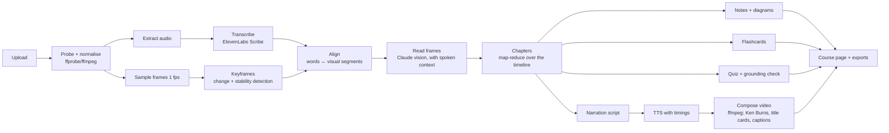

# Lectern: build plan

> Working name **Lectern**, which is easy to change. Upload a lecture video and get back a course:
> chaptered notes, diagrams, flashcards, a quiz and a 60–90 second AI-narrated summary video.
> Every item links back to the exact moment in the lecture it came from.

## 1. Goals

| Goal | What "done" looks like |
|---|---|
| Showcase quality | Every page uses the DevSwarm Apple theme. No dead ends, no raw errors or spinners without progress. Works on mobile and in light and dark mode. |
| Real multimodal sync | Every note, card and question carries a timestamp and the frame it came from. Clicking it seeks the player there. |
| Handles long lectures | A 90-minute lecture finishes, survives a crash mid-run, and resumes without paying for finished steps again. |
| Honest quality | A small eval set measures keyframe recall, handwriting accuracy (CER) and quiz grounding. The numbers go in the README. |
| Explained | README, ARCHITECTURE, HOW_IT_WORKS and LEARNING (the decision log) are written as each milestone is built, not at the end. |

**Out of scope for v1:** YouTube URL import (licensing), user accounts, languages other than English (Scribe supports them, but prompts and evals are English only), and editing generated content.

## 2. Decisions made

| Area | Choice | Why |
|---|---|---|
| Reasoning + vision | **Headless Claude Code** (`claude -p --json-schema`) behind an `LLM` interface | No API billing. `--json-schema` gives validated structured output, and the Read tool can open frame images. An Anthropic API backend can be added later behind the same interface for cloud hosting. |
| Speech-to-text | **ElevenLabs Scribe** | Word-level timestamps (needed for sync), speaker diarization, and long files. One vendor for speech and voice. |
| Voice | **ElevenLabs TTS** with timestamps | Most natural voice. Character timings make captions frame-exact. |
| Computer vision | OpenCV + NumPy (CPU) | Keyframe detection is deterministic signal processing. No model is needed, and it runs fast on this machine, which has no GPU. |
| Media | ffmpeg / ffprobe via subprocess (argument lists, never a shell string) | The standard tools, and it's how DevSwarm calls Docker too. |
| Web | FastAPI + Jinja + HTMX + small vanilla JS, reusing DevSwarm's `dashboard.css` | Same theme pixel for pixel and one Python codebase. |
| State | SQLite (WAL) for jobs and stages, files on disk for artifacts | Resumable, inspectable and has nothing to operate. |
| Hosting | This machine behind a Cloudflare Tunnel. Free public gallery of sample lectures, plus uploads gated by access code with a queue and daily limits | Claude Code only runs here, so access codes keep usage bounded. |
| Tooling | uv, ruff, mypy (strict), pytest, GitHub Actions | Same as DevSwarm. |

## 3. Pipeline



### 3.1 Stages in detail

1. **Probe and normalise.** ffprobe validates the container, duration (cap 120 min) and streams. A lecture with no video stream is rejected early, with a clear message. A video with variable frame rate is normalised so frame timestamps are trustworthy.
2. **Audio.** Extract mono 16 kHz audio. Scribe takes long files directly. If a file is over the API limit, split it on silence (from `silencedetect`) with a 2-second overlap, then stitch the words back together on the overlap. Results are cached by audio hash.
3. **Keyframes** (hard part #1, the visual side):
   - Sample at 1 fps in greyscale at 320 px wide, and compute frame-to-frame change (mean absolute difference plus SSIM on a grid).
   - *Slides* change in steps, so a sharp spike marks a boundary.
   - *Whiteboards* change gradually, so a boundary is an erase (a drop in ink pixels) or a pan. Within each stable window, pick the **most complete and sharpest** frame: the most ink plus the highest Laplacian variance, with frames where a person blocks the board (large foreground blob) penalised.
   - Remove near-duplicates with a perceptual hash, so a slide shown twice is read once and linked to both moments.
   - Talking-head stretches are detected (low text density) and skipped for reading.
4. **Align** (hard part #1, sync): each keyframe owns the interval it is on screen, `[t_start, t_end)`. Transcript words are assigned by their midpoint. The result is a list of **segments**, each with a frame, its interval and the words spoken over it. Segments are the backbone for everything downstream, which is why every output can cite a timestamp.
5. **Read frames** (hard part #2): one Claude call per unique keyframe, run in parallel with a concurrency limit. The prompt includes **the words spoken while the frame was visible**, because a lecturer usually says what they write, and that context resolves messy handwriting. Output is schema-validated JSON: `kind` (slide / whiteboard / code / diagram / other), title, text as Markdown, equations as LaTeX, a diagram description plus a Mermaid reconstruction, and confidence for each item. The text a frame shows is treated as data: the call can only use the Read tool, inside that job's frame folder.
6. **Chapters** (hard part #3, long videos): a condensed timeline (frame titles plus a short summary of each segment) is split into windows of about 15 minutes. Each window proposes topic boundaries (map), then one call merges them into 4–12 chapters with titles (reduce). Context stays small however long the lecture is.
7. **Generate**, per chapter and in parallel:
   - **Notes:** Markdown with headings, LaTeX, key terms and embedded keyframes, each paragraph tagged with its source time range.
   - **Diagrams:** Mermaid. Each one is syntax-checked, and failures are retried once with the error message, then dropped (never shown broken).
   - **Flashcards:** front, back, source timestamp and an optional image.
   - **Quiz:** multiple choice with plausible distractors and an explanation. A **grounding check** pass confirms each answer is supported by the transcript or frame text, and removes questions that aren't.
8. **Summary video:** Claude writes a 60–90 second script as scenes, each tied to a keyframe or a title card. ElevenLabs reads it with character timings. ffmpeg builds 1080p: a slow Ken Burns move on keyframes, title cards drawn in the Apple style with Pillow, burned-in captions (ASS) timed from the TTS, and gentle crossfades. A 1080×1350 portrait version is also made for LinkedIn.
9. **Exports:** the course page, a Markdown zip with images, an Anki deck (`.apkg`), and a print stylesheet for PDF.

### 3.2 Orchestration

- A job is a DAG of stages stored in SQLite with status `pending/running/done/failed/skipped`, attempts, timings and an error.
- Each stage is a pure function from input artifacts to output artifacts, keyed by a **content hash** of its inputs, prompt version and model. Re-running a finished stage hits the cache, so a crash or a code change re-runs only what changed.
- One worker process pulls jobs from the queue. Inside a job, independent stages run concurrently (transcription runs alongside keyframe detection). Fan-out stages (frame reading, per-chapter generation) run in parallel with a limit.
- Retries use backoff on transient errors (rate limits, timeouts). A permanent error fails the stage with a readable message, and other branches still finish, so a broken diagram never stops the quiz.
- Progress events, such as "Reading frame 34 of 112", are written to the DB, and the job page polls them with HTMX, like DevSwarm.
- Costs and durations are recorded for each stage and shown on the job page, because clients ask about them.

## 4. Product surface

| Page | Contents |
|---|---|
| **Home** | Large Apple-style hero, an upload drop zone (access code field), and a gallery of sample courses. |
| **Job** | Live stage timeline (the DevSwarm `_status` style): each stage's state, progress, duration and cost. Frames appear as they are found. |
| **Course** | Sticky chapter sidebar. A video player with a **live transcript** (the current word is highlighted, and clicking a word seeks). A keyframe filmstrip under the scrubber. Tabs for Notes · Diagrams · Flashcards (flip, keyboard shortcuts, "know / again") · Quiz (instant feedback, a "rewatch this moment" link, score) · Summary video · Transcript. |
| **How it works** | An animated walkthrough of one lecture going through the pipeline, like DevSwarm's page. |
| **Help** | The same FAQ popover pattern as DevSwarm. |

The theme comes from DevSwarm's `dashboard.css`: its tokens (`--page`, `--surface`, `--ink`, `--action`, `--radius: 22px`, `--pill`), the system font stack, the frosted header, the sun/moon theme switch and the shadows. New components (filmstrip, flashcard, quiz option) are built only from those tokens.

## 5. Code layout

```
lectern/
  config.py            settings from env (.env), limits
  media/               ffprobe, ffmpeg wrappers, frame sampling
  vision/              keyframe detection, dedupe, sharpness, occlusion
  speech/              Transcriber protocol, ElevenLabs Scribe, fake
  voice/               Narrator protocol, ElevenLabs TTS, fake
  llm/                 LLM protocol, ClaudeCode backend, scripted fake
  pipeline/            stage DAG, cache, worker, events, stages/*.py
  generate/            prompts + schemas: frames, chapters, notes, cards, quiz, script
  render/              summary video composition, title cards, captions
  export/              markdown zip, anki, print
  web/                 FastAPI app, templates, static (theme)
  cli.py               `lectern run video.mp4`, `lectern serve`, `lectern eval`
tests/                 offline, synthetic videos generated in fixtures
evals/                 labelled samples + metrics
docs/                  PLAN, ARCHITECTURE, HOW_IT_WORKS, LEARNING, DEMO
```

## 6. Milestones

Each milestone ends with: tests green, a demo, docs updated, a commit, and a check-in.

| # | Milestone | Demo at the end |
|---|---|---|
| **M0** | Scaffolding: uv project, ruff/mypy/pytest, CI, the DevSwarm theme ported into an empty app shell, docs skeleton | `lectern serve` shows the themed shell in light and dark |
| **M1** | Pipeline core (stage DAG, content-hash cache, SQLite, events, resume) + probe/audio + Scribe transcription | `lectern run talk.mp4` → `transcript.json`. Killing it and re-running resumes |
| **M2** | Keyframe detection + alignment, tested on synthetic slide and whiteboard videos rendered in fixtures | A contact sheet of the detected keyframes with their time ranges |
| **M3** | Claude Code LLM backend + frame reading with spoken context | Frame-by-frame JSON for a real whiteboard lecture |
| **M4** | Chapters, notes, Mermaid diagrams, flashcards, quiz + grounding check | Complete course JSON + Markdown |
| **M5** | Summary video: script → TTS → ffmpeg composition, landscape and portrait | A playable `summary.mp4` |
| **M6** | Web app: upload, live job page, course page with synced player/transcript, flashcards, quiz, exports | The full flow in the browser |
| **M7** | Evals: keyframe recall, handwriting CER, quiz grounding rate. Hardening: limits, errors, empty states, mobile | `lectern eval` report. The numbers go in the README |
| **M8** | Launch: access codes + queue + daily limits, Cloudflare Tunnel, sample gallery, How-it-works page, README with GIFs, LinkedIn assets | A live URL |

## 7. Risks

| Risk | Mitigation |
|---|---|
| Headless Claude Code is slow per call, and a lecture has about 100 frames | Dedupe frames, skip talking-head frames, run calls in parallel with a limit, cache by hash. Measured in M3. |
| A presenter blocks the whiteboard | Pick the best frame in each stable window, penalise frames with large foreground blobs, and merge text across neighbouring frames of the same board. |
| The model invents content | Spoken context is in each prompt, confidence is recorded per item, the quiz is grounding-checked, and every item cites its source timestamp so a viewer can check it. |
| Prompt injection through slide text | The LLM call has only the Read tool, inside the job's folder: no shell, no network, no writes. Output must match the schema. |
| Sample lecture licensing | Use openly licensed lectures (e.g. MIT OpenCourseWare, CC BY-NC-SA), credited on the course page. |
| The public demo exhausts Claude usage | Access codes, one job at a time, a daily cap and a maximum video length. The gallery is free to browse. |

## 8. Needed from you

- `ELEVENLABS_API_KEY` in `.env` (needed from M1).
- The DNS subdomain for the Tunnel (M8), e.g. `lectern.devanshitiwari.com`.
- Approval of 2–3 sample lectures (M7). I'll propose MIT OCW picks: one slides, one blackboard, one handwritten tablet.
